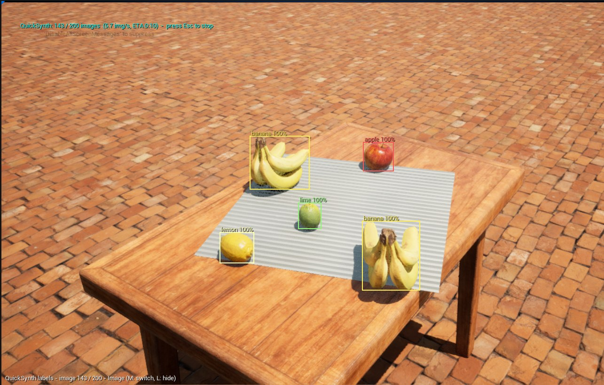

# 7. Checking your labels

**Label overlay.** While capturing, the viewport shows each captured image with its boxes, class names and visible %,
with filtered-out objects in grey. Press **L** to hide or show it and **M** to switch to the **instance mask** (a
color per object) or **semantic mask** (a color per class). It's drawn on screen only and never ends up in your
images.

**Dry Run.** Tick *Dry Run* on the Manager and press Play (or Generate): QuickSynth runs the whole process with the
overlay, slowly enough to watch (*Dry Run Seconds Per Image*), but writes no files. Use it to check framing, labels
and visibility filtering before a long run.

**Label Previews.** Tick *Write Label Previews* on the Manager to save a JPG copy of every image with its boxes drawn
on, in `previews/`. Flip through them in any image viewer.

**The report.** Every run writes `quicksynth_report.txt`: labels per class, how many objects the visibility filter
left out, images with no labels, skipped viewpoints, and an automatic check that every box is inside its image and
matches its mask.

