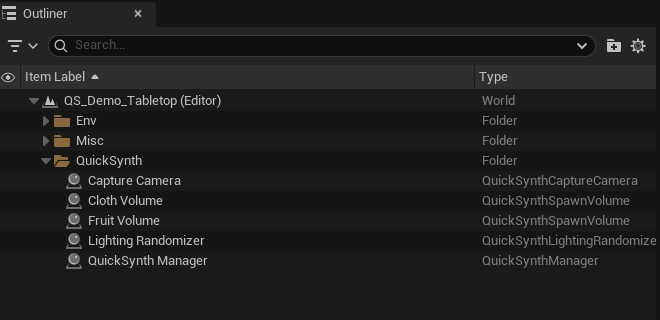

# 2. Quick start: your first dataset in 5 minutes

1. **Open a level** with a floor (or create a new *Basic* level).
2. **List your objects.** In the Content Browser, right-click → **QuickSynth → Object Library** and open it. Under
   **Objects**, click **+** for each kind of object: type its class name in **Label** (for example `box`) and add its
   mesh under **Meshes** (for example a cube or one of your props).
3. **Add a Spawn Volume.** From *Place Actors → QuickSynth*, drag a **QuickSynth Spawn Volume** in. Move it so its
   **bottom face rests on the floor**, scale it over the area where objects should appear, and drop your Object
   Library into its **Object Library** field.
4. **Add a camera.** Drag a **QuickSynth Capture Camera** in and point it at the volume like any camera (tip:
   right-click it → *Pilot* to aim through it).
5. **Add a Manager.** Drag a **QuickSynth Manager** in. It holds the dataset's settings: number of images,
   resolution, output formats. Pick your camera in its **Capture Camera** and add your volume to its **Spawn
   Volumes** (the eyedropper lets you click them in the viewport). The Manager only uses what you pick.
6. **Check the setup.** Click the **QuickSynth** toolbar button → **Validate Scene**. Fix anything it reports
   (see [§5](validate-scene-every-check-explained.md#5-validate-scene-every-check-explained)).
7. **Generate.** Click **QuickSynth → Generate Dataset**. The level plays, objects are shuffled for every image, the
   viewport shows each captured image with its boxes, and a notification shows progress. Play stops by itself when
   the dataset is done (100 images by default).
8. **Open it.** Click **Open Output Folder** in the "done" notification. You'll find a `yolo/` folder that is ready
   to train on (see [§8](using-the-dataset.md#8-using-the-dataset)).

*A finished setup (the demo map): the Manager, the Capture Camera, two Spawn Volumes and a Lighting Randomizer.*

That's the whole workflow. Everything else in this guide is about making the dataset better.

**Want to see a finished setup first?** Open the demo map `LV_Demo_Tabletop` (Content Browser → enable *Show
Plugin Content* → QuickSynth Content → Maps) and press Play. It shows fruit detection with distractors,
random cloth surfaces, lighting changes and a camera orbiting the fruit at random.

